<p align="center">
  
</p>

<p align="center">
  <b>Un sistema operativo móvil libre, con kernel Linux y gestor de paquetes propio.</b><br>
  Sin APKs, sin servicios de Google y con todo el código abierto.
</p>

<p align="center">
  <a href="https://github.com/Open-Cosmic-Project/Cosmic-Manifest">Descargar el árbol</a> ·
  <a href="https://github.com/Open-Cosmic-Project/Docs">Documentación</a> ·
  <a href="https://github.com/Open-Cosmic-Project/Kernel">Kernel</a> ·
  <a href="https://github.com/Open-Cosmic-Project/Pkg">SPS</a>
</p>

> **Estado: experimental.** Todo el desarrollo está en la rama `eventhorizon`. Todavía no hay dispositivos soportados ni imágenes para instalar.

Despliega las secciones para ver más. 👇

<details open>
<summary><b>🌌 ¿Qué es CosmicOS?</b></summary>

&nbsp;

CosmicOS es una alternativa a Android e iOS pensada primero para el **móvil** y después para el escritorio. Parte de una idea: lo que corre en tu teléfono debería ser auditable, y el usuario debería poder desbloquearlo, cambiarlo y volver a bloquearlo.

| Principio | Qué significa |
|---|---|
| **Kernel mínimo** | Linux 6.18 LTS podado a `arm64` y `riscv`, con parámetros fijos en la compilación |
| **Paquetes nativos** | Paquetes `.sps`: un binario nativo más un `Manifest.json` con permisos y bibliotecas mínimas |
| **Aislamiento por defecto** | Cada app y cada demonio en su propio sandbox, con SELinux, namespaces y Landlock |
| **Sin Google** | Sin GMS ni APKs; notificaciones push propias y autoalojables; casi nada sale del teléfono |
| **Tuyo de verdad** | Bootloader desbloqueable y relockable, sin eFUSE que impida bajar de versión |
| **Código abierto** | Solo licencias GPL, LGPL y AGPL para el código propio |

</details>

<details>
<summary><b>🧱 Arquitectura</b></summary>

&nbsp;

<p align="center">
  
</p>

- **`cinitd`** es el init (PID 1), escrito en Rust y sin systemd.
- **`kernel.root`** es un supervisor de solo lectura: reinicia en su sandbox los procesos que se cuelgan, y no se puede matar ni siendo root (salvo en modo Desarrollador).
- **`clauncher`** aplica la política del manifiesto de cada app y hace `exec`.
- Los **demonios** (`c<nombre>d`) son procesos pequeños y aislados: logging, notificaciones, permisos, energía, ajustes, actualizaciones, push y firewall.

</details>

<details>
<summary><b>🛰️ Canales de publicación</b></summary>

&nbsp;

<p align="center">
  
</p>

La rama del manifest es el canal. Hoy todo vive en `eventhorizon`; cuando el sistema madure, la rama por defecto pasará a `quasar`.

| Canal | Para qué |
|---|---|
| `eventhorizon` | Ultraexperimental. De aquí pueden salir cambios que luego suben de canal |
| `quasar` | Rolling: cada commit es una actualización |
| `pulsar` | Beta |
| `nebula` | Estable |
| `singularity` | LTS |

</details>

<details>
<summary><b>📦 Repositorios</b></summary>

&nbsp;

Cada carpeta del árbol es un repositorio.

| Repositorio | Contenido | Lenguajes | Licencia |
|---|---|---|---|
| [**Core**](https://github.com/Open-Cosmic-Project/Core) | `cinitd`, `kernel.root`, `clauncher`, `cdevd`, `corchd` | Rust, Go | GPL-3.0 |
| [**Daemons**](https://github.com/Open-Cosmic-Project/Daemons) | Demonios del sistema | Rust | GPL-3.0 / AGPL-3.0 |
| [**UI**](https://github.com/Open-Cosmic-Project/UI) | PhanteonWM, CreationDE, teclado, pantalla de arranque | Rust, C++ | GPL-3.0 |
| [**Pkg**](https://github.com/Open-Cosmic-Project/Pkg) | SPS, el gestor de paquetes | Rust | GPL-3.0 |
| [**Tools**](https://github.com/Open-Cosmic-Project/Tools) | `cosmic-build`, `cosmic-repo`, `cosmic-flash`, `fastboot`, `cad` | Go, Rust, C++ | GPL-3.0 |
| [**Kernel**](https://github.com/Open-Cosmic-Project/Kernel) | Linux 6.18 LTS purgado, configuraciones y scripts | C | GPL-2.0 |
| [**Libs**](https://github.com/Open-Cosmic-Project/Libs) | `cosmic-core`, `cosmic-usb` | Rust, C | GPL-3.0 |
| [**Sdk**](https://github.com/Open-Cosmic-Project/Sdk) | SDK para desarrollar apps | Rust | LGPL-3.0 |
| [**Patches**](https://github.com/Open-Cosmic-Project/Patches) | Parches de Chromium y Qt | — | la del proyecto parcheado |
| [**Device**](https://github.com/Open-Cosmic-Project/Device) | Firmware y paquetes por dispositivo | — | por definir |
| [**Cosmic-Workspace**](https://github.com/Open-Cosmic-Project/Cosmic-Workspace) | `Cargo.toml` y configuración de Rust de la raíz | — | GPL-3.0 |
| [**Cosmic-Manifest**](https://github.com/Open-Cosmic-Project/Cosmic-Manifest) | Manifest de `repo` para bajar todo el árbol | — | — |
| [**Docs**](https://github.com/Open-Cosmic-Project/Docs) | Especificación y guías | — | por definir |

Los módulos que tocan la red (`cpushd`, `cfronterad`) van con AGPL; el SDK, con LGPL para que las apps de terceros puedan usarlo.

</details>

<details>
<summary><b>⬇️ Descargar y compilar</b></summary>

&nbsp;

Necesitas [`repo`](https://gerrit.googlesource.com/git-repo), Rust y Go.

```sh
mkdir cosmicos && cd cosmicos
repo init -u https://github.com/Open-Cosmic-Project/Cosmic-Manifest.git -b eventhorizon -g desktop-dev
repo sync -j4

cargo check                  # el hito 1
./cosmic-build milestone1    # compila el hito 1
```

`desktop-dev` trae todos los crates de Rust. El kernel (≈1,6 GB) viene en el repo `Kernel`.

</details>

<details>
<summary><b>🚧 Estado del proyecto</b></summary>

&nbsp;

| Estado | Qué |
|---|---|
| ✅ Compila | `cinitd`, `kernel.root`, `clauncher`, `sps`, `cosmic-core`, `cosmic-repo` (hito 1) y el sistema de construcción `cosmic-build` |
| ✅ Descargable | El árbol completo con `repo`, incluido el kernel |
| 🚧 En marcha | Compilación cruzada a arm64 y riscv64, imagen única con instalador gráfico, demonios y UI |
| ⏳ Aplazado | `fastboot` y `cad` (herramientas USB), `cosmic-flash` |
| 🔭 Por llegar | Primer dispositivo (Motorola o Pixel), canales `quasar` y `pulsar` |

</details>

<details>
<summary><b>📡 Actividad reciente</b></summary>

&nbsp;

Se actualiza sola cada semana con la API de GitHub.

<!-- REPOS:START -->
<!-- REPOS:END -->

</details>

<details>
<summary><b>🤝 Participar</b></summary>

&nbsp;

El proyecto es muy joven. Lo más útil ahora mismo:

- Abrir un *issue* en el repositorio que corresponda con lo que veas roto o confuso (hay formularios para fallos y propuestas).
- Leer la especificación en [Docs](https://github.com/Open-Cosmic-Project/Docs) y señalar lo que no cierre.
- Probar `repo sync` y `./cosmic-build` en tu máquina y contar qué falla.

Las reglas están en [CONTRIBUTING](https://github.com/Open-Cosmic-Project/.github/blob/HEAD/CONTRIBUTING.md). La documentación está en español; el inglés llegará más adelante.

</details>

<p align="center"><sub>CosmicOS · Open Cosmic Project</sub></p>
